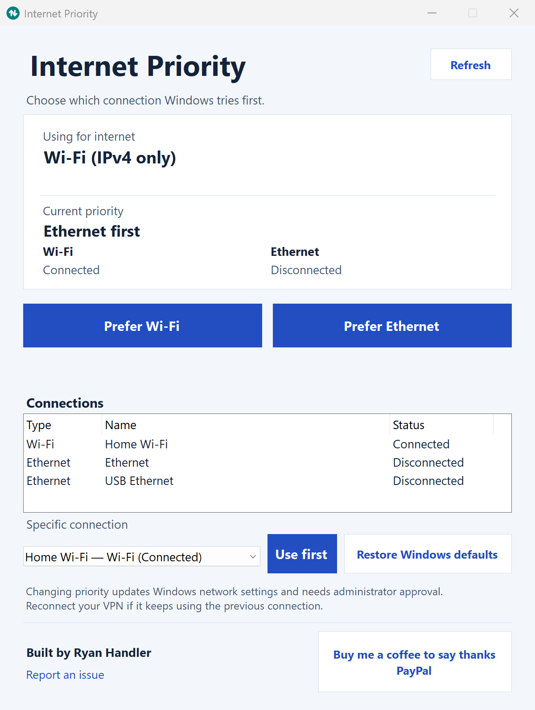

# Internet Priority

Internet Priority is a Windows utility for seeing which connection Windows is routing internet traffic through and choosing a preferred Wi-Fi or Ethernet adapter. Built by Ryan Handler.

**[Download the Windows installer (.msi)](https://github.com/shwartzewolf/internet-priority/releases/download/v1.5.0/Internet.Priority.Setup.msi)**

Version 1.5.0 is unsigned. [Release notes and SHA-256 checksum](https://github.com/shwartzewolf/internet-priority/releases/tag/v1.5.0)

## Install and use

Run the MSI to install the app for the current user and add an **Internet Priority** desktop shortcut.

- **Using for internet** shows the adapter Windows selects for representative public IPv4 and IPv6 destinations. It refreshes every five seconds. A VPN or destination-specific route can change the result.
- **Connections** lists detected Wi-Fi, Ethernet and active VPN connections. **Current priority** shows the configured preference separately.
- Use **Prefer Wi-Fi**, **Prefer Ethernet**, or select a specific adapter and click **Use first**. Windows asks for administrator approval before the app changes Wi-Fi or Ethernet interface metrics.
- **Restore Windows defaults** turns automatic priority back on for Wi-Fi and Ethernet adapters. To uninstall, find **Internet Priority** in **Settings → Apps → Installed apps**. Use the restore button first if you want to return to automatic priority.

## Build on Windows

Open Windows PowerShell 5.1 in the source directory and run `powershell.exe -NoProfile -File .\Build.ps1`. The build uses the Windows .NET Framework compiler and built-in Windows Installer tools. It produces `dist\Internet Priority.exe` and `dist\Internet Priority Setup.msi`.

## Code signing policy

The first public release is unsigned. The project plans to use free code signing provided by [SignPath.io](https://about.signpath.io/product/open-source), certificate by [SignPath Foundation](https://signpath.org/), subject to acceptance.

[Ryan Handler](https://github.com/shwartzewolf) is the project author, reviewer and release approver. Signing requests must come from the repository's GitHub-hosted Windows build. The maintainer checks the source revision and build before approving each release. The signing workflow covers the installer and the app executable it contains.

## Privacy

The app reads connection names and routing information locally. Its route lookups do not send packets, and the app has no telemetry or update service. Clicking **Report an issue** or the optional PayPal support button opens the chosen site in your browser. [GitHub privacy statement](https://docs.github.com/en/site-policy/privacy-policies/github-general-privacy-statement) · [PayPal privacy statement](https://www.paypal.com/uk/legalhub/paypal/privacy-full)

## License

Released under the [MIT License](LICENSE).
